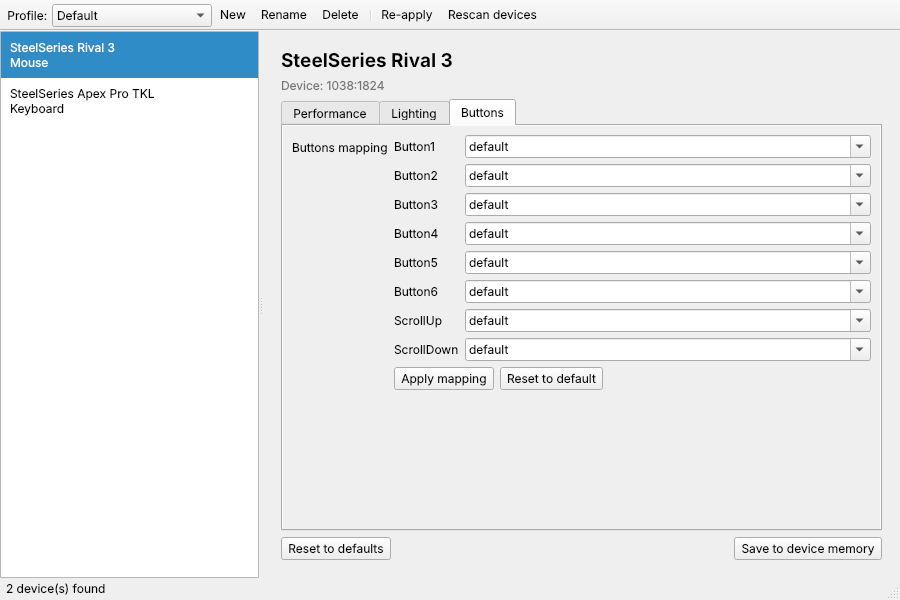

# SteelPanel

A Linux desktop app for SteelSeries mice and keyboards: DPI presets, polling
rate, button mapping and RGB lighting, with named profiles you can switch from
the system tray.


| Lighting | Button mapping | Keyboard |
|---|---|---|
|  |  |  |

## How it works

SteelSeries doesn't publish its USB protocols and GG doesn't run on Linux, so
SteelPanel builds on two open-source projects that reverse-engineered them:

| Device | Backend | What you can change |
|---|---|---|
| Mice (Rival, Aerox, Prime, Sensei, Kana, Kinzu; ~70 models) | [rivalcfg](https://github.com/flozz/rivalcfg), direct USB HID | DPI presets, polling rate, LED colors and effects, button mapping, model-specific options, saving to onboard memory |
| Keyboards (Apex) and other RGB gear | [OpenRGB](https://openrgb.org) SDK server | Lighting effect, color, per-zone color, brightness, effect speed |

The GUI is generated from each device's capability description, so any mouse
that rivalcfg supports gets the right controls automatically.

## Install

```bash
python3 -m venv ~/.local/share/steelpanel-venv
~/.local/share/steelpanel-venv/bin/pip install .
ln -s ~/.local/share/steelpanel-venv/bin/steelpanel ~/.local/bin/steelpanel
```

Arch/Fedora/Debian users may need the Qt runtime libraries
(`libegl1 libxkbcommon0 libfontconfig1`); they're already present on any
normal desktop install.

### Mice: allow access without root

```bash
sudo ~/.local/share/steelpanel-venv/bin/steelpanel --install-udev
```

Then unplug and replug the mouse.

### Keyboards: run OpenRGB's server

1. Install OpenRGB from your distro or [openrgb.org](https://openrgb.org), including its
   udev rules (`60-openrgb.rules`, shipped with the distro packages).
2. Start the SDK server: `openrgb --server` (or enable "Start server" in
   OpenRGB's settings and have it autostart).

Use `STEELPANEL_OPENRGB_HOST` / `STEELPANEL_OPENRGB_PORT` if it doesn't run on
`127.0.0.1:6742`.

## Use

```bash
steelpanel                  # open the GUI
steelpanel --list           # print detected devices and their settings
steelpanel --apply Gaming   # apply a profile and exit (scriptable)
steelpanel --hidden         # start in the tray
```

- Changes apply to the hardware immediately and are saved to the active
  profile (`~/.config/steelpanel/profiles.json`).
- **New…** creates a profile as a copy of the current one. Switch profiles
  from the toolbar or the tray icon's menu.
- Most mice forget their settings when unplugged. Either click **Save to
  device memory**, or let SteelPanel re-apply the active profile at login:

  ```bash
  cp packaging/steelpanel-autostart.desktop ~/.config/autostart/
  cp packaging/steelpanel.desktop ~/.local/share/applications/
  ```

## Development

```bash
pip install -e '.[test]'
pytest
```

The tests use rivalcfg's dry-run HID device and a fake OpenRGB client, so they
need no hardware. Every mouse profile rivalcfg knows is exercised. To click
through the GUI with a simulated mouse:

```bash
RIVALCFG_DRY=1 RIVALCFG_PROFILE=1038:1824 steelpanel
```

### Adding a backend

Implement `steelpanel.model.Backend` (returning `Device` objects that describe
their settings as `Setting` specs) and register it in
`steelpanel/backends/__init__.py`. The GUI and profiles need no changes.

### Layout

```
steelpanel/
  model.py            Device / Setting / Backend abstractions
  profiles.py         JSON profile store + apply_profile()
  backends/rival.py   mice via rivalcfg
  backends/openrgb.py keyboards via OpenRGB SDK
  gui/                PySide6 window, per-setting editor widgets
  __main__.py         CLI entry point
tests/                pytest suite (no hardware needed)
```
